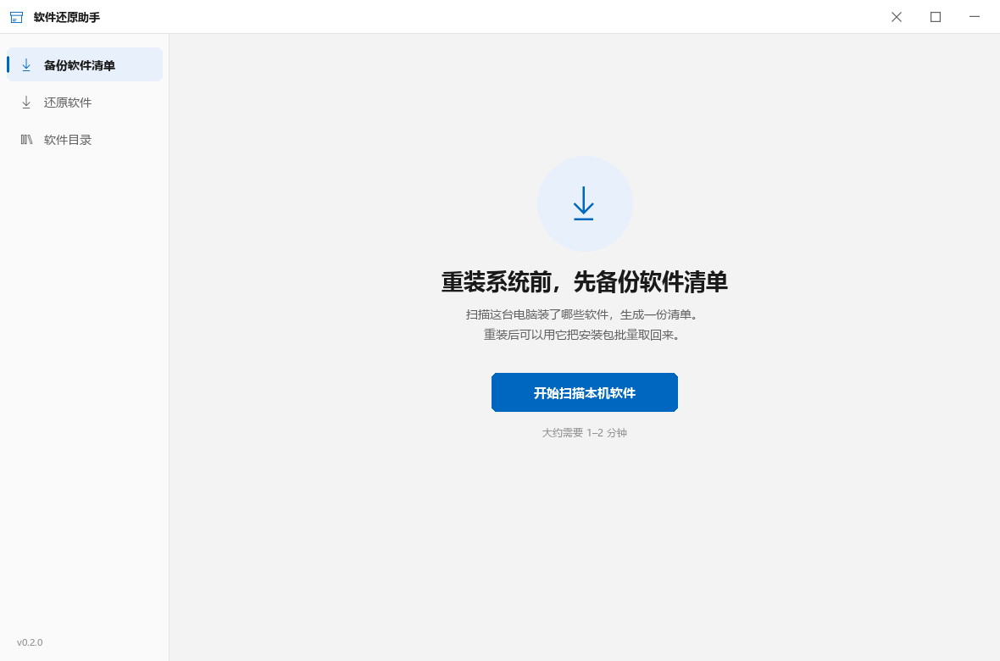
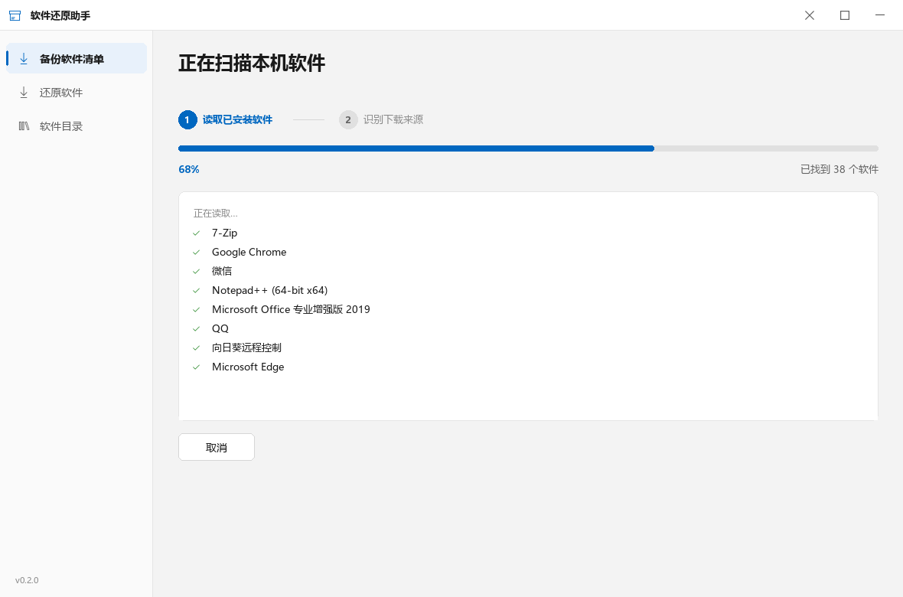
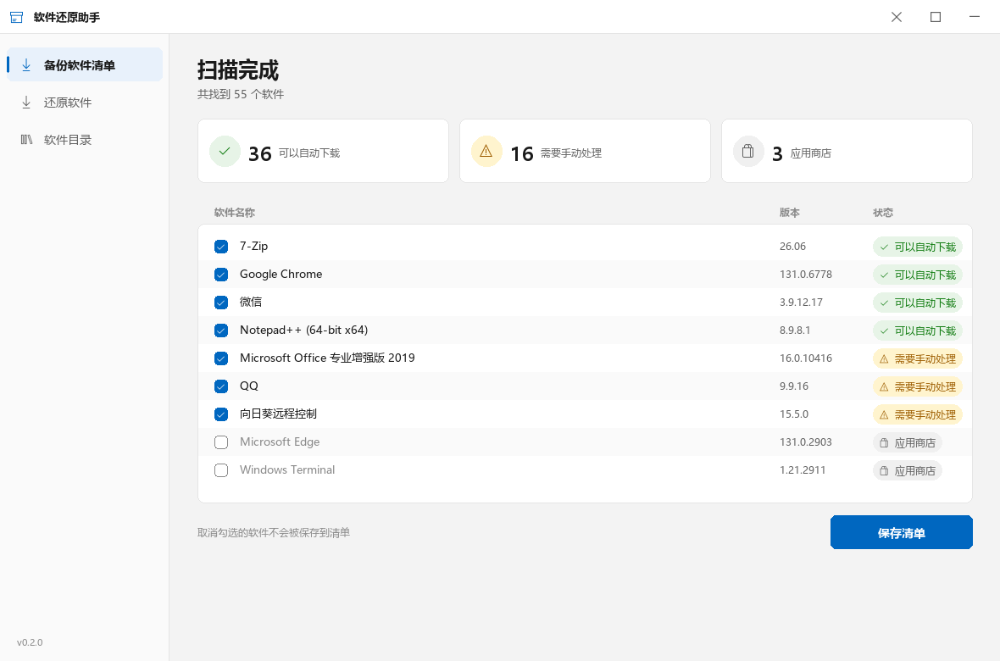
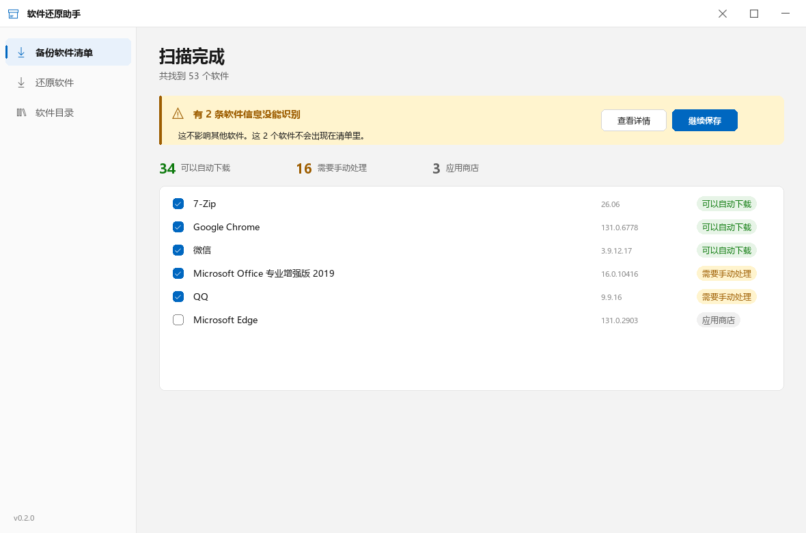
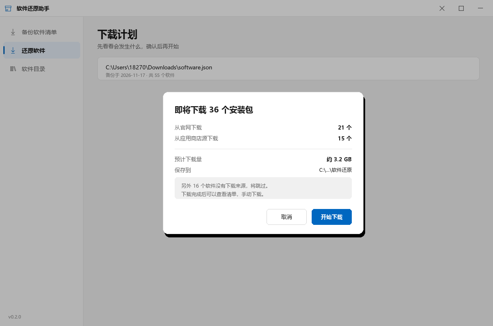
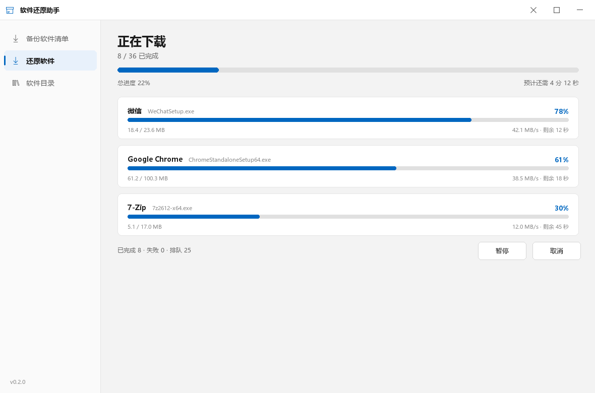
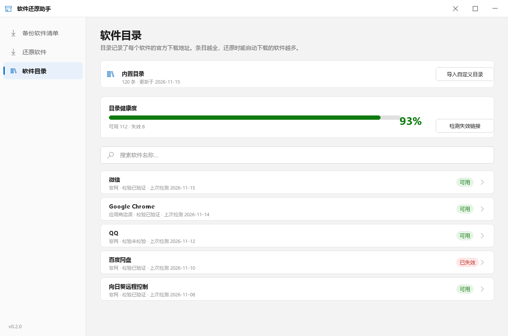
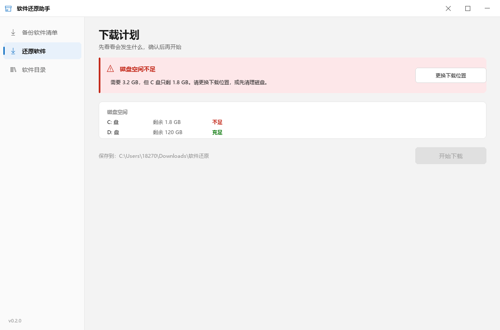
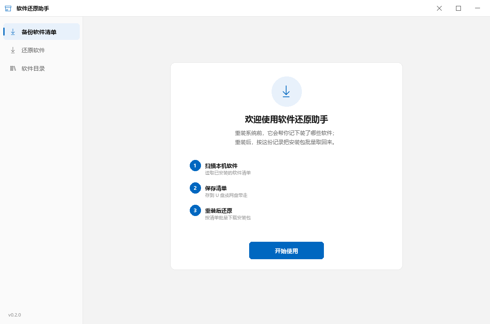

# 08 · 客户端产品与界面设计（v2）

> **状态：设计定稿，实现延后。**
> 本文从**产品经理与用户视角**定义客户端：用户是谁、在什么场景下打开它、每一步看到什么、卡住时怎么办。
> 原型图见 [`prototypes/`](prototypes/)，可重新渲染（`python gen_backup.py` 等）。
> 本轮不改动 `src/` 与 `tests/`，现有 64 项测试保持全绿。

---

## 0. 一句话

> **让一个不懂命令行的普通人，在重装电脑这天，敢点、会用、不慌。**

现有 CLI 要求用户：装 Python → 配环境变量 → 开终端 → 记住命令。**四道门槛，每一道都会流失大部分目标用户。** 本文解决的不是「功能有没有」，而是「普通人能不能用」。

---

## 1. 用户是谁

### 1.1 主用户画像

| 维度 | 描述 |
|---|---|
| 身份 | 普通 Windows 用户，非开发者 |
| 技术水平 | 会用浏览器、会装软件，不知道什么是注册表和 winget |
| 触发场景 | **一年 1–3 次**：换新电脑、系统崩了、C 盘满了被迫重装 |
| 心理状态 | 焦虑（怕丢东西）、不耐烦（重装已经很烦）、不信任（怕下到病毒） |
| 时间压力 | 重装当天要恢复生产力 |
| 关键诉求 | 「别让我漏」「别让我下到假包」「别让我搞砸」 |

### 1.2 用户此刻在怕什么

**每一个恐惧都要在界面上被回应。**

| 恐惧 | 用户心里的话 | 界面必须回答 | 落点 |
|---|---|---|---|
| 怕漏 | 「会不会漏了重要的？」 | 完整列出 + 标出搞不定的 | §5.3 三色统计 |
| 怕假包 | 「这个 exe 是不是被改过？」 | 来源类型 + 校验状态 | §6.2 来源标注 |
| 怕搞砸 | 「点了会不会乱装东西？」 | 明确「只下载，不安装」 | §6.5 完成页 |
| 怕丢失 | 「清单存哪了？重装后还在吗？」 | 显眼路径 + **主动离机** | §5.4 |
| 怕卡住 | 「是不是死机了？」 | 全程进度 + 文字说明 | §5.2、§6.4 |
| 怕看不懂 | 「这些术语是什么？」 | 全中文，无裸术语 | §3.2 |

### 1.3 三类用户，三种需求

| 用户 | 特征 | 需要什么 | 设计对策 |
|---|---|---|---|
| **小白用户** | 不懂技术，怕出错 | 少做决定，最好一键 | 大按钮、默认值、明确的下一步 |
| **普通用户** | 会用但不想学 | 看得懂、能控制 | 预览确认、可排除、进度可见 |
| **进阶用户** | 会看文档、愿编辑 JSON | 批量操作、可脚本化 | 保留 CLI、目录可导入、报告可导出 |

---

## 2. 用户旅程与三个致命失败点

### 2.1 完整时间线

```
【重装前 · 旧电脑】
  打开工具 → 扫描 → 检查清单 → 保存 → 带离这台电脑（关键！）
         ↓
【重装 · 装系统】
         工具不参与
         ↓
【重装后 · 新电脑】
  重新拿到工具 → 加载清单 → 对比当前机器 → 下载缺的
         ↓
  双击安装包，一个个装（工具不参与）
```

### 2.2 三个致命失败点（本设计的核心）

产品一年只用两次，**用户最容易在这三处放弃**：

| # | 失败点 | 为什么会发生 | 设计对策 | 原型 |
|---|---|---|---|---|
| **①** | **忘记把清单带离本机** | 重装会格式化磁盘，JSON 默认在 C 盘。用户「焦虑且不耐烦」时会跳过提示 | 保存后**独占一屏**，用后果句式 + 三种离机方式 | [v2-01](prototypes/v2-01-备份-清单离机.png) |
| **②** | **重装后找不到工具本身** | 系统干净了，工具也没了 | 清单可**发到微信**（用户已会的动作），工具可从固定网址重下 | [v2-01](prototypes/v2-01-备份-清单离机.png) |
| **③** | **下完不知道下一步** | 面对 36 个 exe 会懵 | 完成页给「接下来」+ 失败分诊 | [v2-03](prototypes/v2-03-还原-失败分诊.png) |

> **为什么这三条是核心**：`产品功能说明.md` §12 检查清单里它们都有对应项，但 CLI 只能写在文档里靠用户记得。**GUI 的价值就在于在正确的时刻主动介入。**

---

## 3. 设计原则

### 3.1 五条铁律

| 原则 | 含义 | 反面例子 |
|---|---|---|
| **不吓人** | 不出现技术术语、不弹红色警告轰炸 | 「winget parse error 0x80072efd」 |
| **不失控** | 批量操作前先给用户看会发生什么 | 点「下载」立刻下 50 个包 |
| **不静默** | 每个耗时操作都有进度和说明 | 转圈 3 分钟没有任何文字 |
| **不欺骗** | 做不到的明确说，不假装成功 | 下载失败显示「完成」 |
| **不越界** | 只下载，不安装，不修改系统 | 下载完自动运行安装程序 |

### 3.2 语言规范（术语任务化）

**所有面向用户的文案必须遵守**：

| 禁止（技术词） | 改为（任务词） |
|---|---|
| `winget` | 应用商店源 / 系统包管理器 |
| `SHA256` | 文件校验值 |
| `catalog` | 软件目录 |
| `inventory` | 软件清单 |
| `parse_errors` | 有 N 条信息没能识别 |
| `unresolved` | 没找到下载来源 |
| `HTTP 404` | 下载地址已失效 |
| `HashMismatch` | 文件校验未通过 |
| 「备份 / 还原」 | 「重装前：保存软件清单」/「重装后：下载安装包」 |
| 「健康度」 | 「可自动下载 38 / 47」 |

> 术语任务化的理由见 §9 审查结论 S4：「备份」「还原」「健康度」是开发者语汇，用户说的是「换电脑」「把软件搬过去」。

### 3.3 状态标记：三态而非四态

**审查发现**：`⊘`（不可用）与 `✗`（失败）在普通用户眼中是同一个意思。

**收敛为三态，按「用户要做什么」划分**：

| 标记 | 文案 | 用户要做什么 | 颜色 |
|---|---|---|---|
| ✓ | 可以自动下载 | 什么都不用做 | 绿 |
| ⚠ | 需要手动处理 | 记住它，重装后自己下 | 黄 |
| ⊘ | 应用商店 | 重装后从商店「我的应用」还原 | 灰 |

**规则**：符号**永远**跟中文短语，颜色只作辅助（色盲友好）。

---

## 4. 信息架构

### 4.1 三个页面

```
┌─────────────────────────────────────────────────────┐
│  软件还原助手                        [帮助]          │
├─────────────────────────────────────────────────────┤
│  ① 重装前：保存清单  ② 重装后：下载安装包  ③ 软件目录 │
└─────────────────────────────────────────────────────┘
```

| 页面 | 使用时机 | 用户的一句话理解 |
|---|---|---|
| ① 保存清单 | 重装**前** | 「把我现在装的东西记下来」 |
| ② 下载安装包 | 重装**后** | 「把那些软件的安装包下回来」 |
| ③ 软件目录 | 进阶 | 「哪些能自动下，哪些不能」 |

**只有三个页面。** 不做侧边栏、不做设置中心、不做多级菜单。

### 4.2 页面流转

```
首次打开 → 引导（3 步说明）
   │
   ├─ 无清单 ──→ ① 保存清单（带引导语）
   │
   └─ 有清单 ──→ ① 保存清单（默认页）
                    │
                    ├─ 重装前：扫描 → 检查 → 保存 → 离机
                    │
                    └─ 重装后：② → 加载清单 → 对比 → 下载
```

### 4.3 顶部常驻状态

| 状态 | 显示 |
|---|---|
| 未扫描 | `尚未备份` |
| 已扫描未保存 | `已扫描 55 个软件 · 未保存` |
| 已保存 | `清单已保存 · 2026-11-17` |

---

## 5. 页面一：保存清单（重装前）

### 5.1 空状态



**设计要点**：

- 空状态**只做一件事**：引导用户点那个按钮
- 「大约需要 1–2 分钟」——提前管理预期
- 不显示任何技术信息

### 5.2 扫描中



| 元素 | 为什么这样设计 |
|---|---|
| **分两步显示** | 读注册表 / 识别下载来源，用户需要知道在干嘛 |
| 实时滚动列表 | 让用户看到「它在干活」，**防焦虑的核心** |
| 已找到计数 | 数字在涨，用户有安全感 |
| **可取消** | 用户随时能退出（审查 M3 修复） |

**第二步文案**：必须显示 `(23/55)` 这种**确定进度**，不能只转圈。

### 5.3 扫描完成



| 元素 | 为什么 |
|---|---|
| **顶部三色汇总** | 用户第一眼知道「大概能搞定多少」 |
| 状态用中文短语 | 「可以自动下载」而非「已识别」 |
| 复选框默认全选 | 大多数人想全要；取消是例外 |
| 「取消勾选的不会被保存」 | 明确说明，避免误解 |

**必须提供「重新扫描」**（审查 M3 修复），且重扫不丢失已勾选状态。

### 5.4 保存后：清单离机（**本设计的核心创新**）


**这是整个产品最重要的一屏。**

**审查结论 B1**：原设计用一句「强制备份提醒」兜底，等于把产品最关键的失败点外包给了一句文案。用户「焦虑且不耐烦」时会直接跳过提示。

**改进**：

| 设计 | 理由 |
|---|---|
| **独占一屏**，不与列表同屏 | 审查 M2：信息密度过高时用户会漏看提醒 |
| **后果句式**而非提醒句式 | 「重装会清空这台电脑」比「请备份」有力 |
| **三种离机方式并列** | 覆盖不同习惯：微信党 / U 盘党 / 手机党 |
| **「发到微信」作为主按钮** | 这是用户**已经会做**的动作，认知成本最低 |
| **文件名带日期和机器名** | 重装后能一眼认出是哪台机器的清单 |
| 提供二维码 | 手机扫码存相册，不依赖电脑 |

> **为什么「发到微信」是主按钮**：审查指出，用户重装后第一反应是打开浏览器，不是找工具。如果清单在微信里，用户随时能取回，**工具丢了也不致命**。

### 5.5 排除软件

取消勾选后底部出现：`已排除 3 个软件：[查看] [全部恢复]`

**为什么**：用户可能误点，需要能撤回。

### 5.6 识别失败的处理



- **不阻塞**：用户仍可继续
- 说清后果：「这 2 个软件不会出现在清单里」
- 提供反馈途径（复制诊断信息）

---

## 6. 页面二：下载安装包（重装后）

### 6.1 空状态（重装后第一屏）


**审查结论 B2 + S1**：这是用户重装后打开软件的**第一屏**，也是记忆负担最重的一屏。原设计假设用户已经知道该干什么。

**改进：三问三答 + 上次备份回显**

| 设计 | 解决什么 |
|---|---|
| **上次备份回显**（时间/机器名/数量） | S1：低频用户的记忆负担 |
| **「打开这份」主按钮** | 如果文件还在，一键打开，不用找 |
| **三问三答** | B2：「这是什么文件」「上次存哪了」「找不到怎么办」 |
| **「帮我在这台电脑上找找」** | 本地扫描 `软件清单_*.json`，纯本地零依赖 |

### 6.2 增量对比（**本设计的第二个核心创新**）


**审查结论（盲点 #2）**：原设计永远从「清单」出发，**从不从「当前机器装了什么」出发**。这是架构级缺失，导致两个真实场景撑不住：

| 场景 | 原设计 | 改进后 |
|---|---|---|
| 重装到一半想跳过某个 | 只能暂停全部 → 改清单 → 重来 | 取消勾选即可 |
| 重装一周后发现漏了 | 重新下载全部 36 个 | **只显示还差的 7 个** |

**设计**：加载清单后自动扫描当前机器，显示三个数字：

```
7 还差这些（默认只下载这些）  |  42 已经装了  |  3 应用商店
```

**为什么这是性价比最高的功能**：

1. 同时解决「中途跳过」和「事后补漏」
2. 让工具在重装后**一周内反复有用**，直接改善留存
3. 不需要云端、不需要目录数据、复用现有扫描能力

### 6.3 下载前确认（强制）



**为什么强制这一步**：用户最怕「点一下它就开始乱下」。用四条具体信息建立信任：**下多少、从哪下、多大、存哪**。

**审查 M4 修复**：主信息用大字（数量 + 大小），路径次之，来源可折叠。

### 6.4 下载中



| 元素 | 为什么 |
|---|---|
| 每个文件独立进度条 | 用户能看到具体在干什么 |
| **已完成数量**（单调递增） | 审查 M6：剩余时间估算不可靠，已完成数是可靠指标 |
| 剩余时间显示**区间** | 「约 3–5 分钟」而非精确值 |
| 并发 3 个 | 平衡速度与稳定性 |
| 暂停 / 取消 | 用户要临时让出带宽 |

**审查 M6**：前 10 秒不显示剩余时间，只显示「已下载 X / 42」。

### 6.5 下载完成 + 失败分诊


**审查结论 S3**：原设计失败项只展示不分诊，用户面对 12 个失败项无法行动。

**改进：按原因分组，每组一个可执行按钮**

| 分组 | 用户看到的 | 按钮 |
|---|---|---|
| 链接失效 | 「官网换了地址，工具找不到新的」+ **直接给官网地址** | 打开官网搜索 |
| 需要登录 | 「这类下载需要账号，工具不会绕过」 | 打开下载页 |
| 网络问题 | 「网络不稳定，重试通常就能成功」 | 重试这 N 个 |

**关键**：失败项**直接给出可点击的官网地址**，而不是让用户自己去搜（审查盲点 #8）。

**结论句先行**：「42 个成功，5 个需要你手动处理」——先给结果，再给细节。

### 6.6 失败原因的用户语言对照

| 技术原因 | 界面文案 | 提供操作 |
|---|---|---|
| `http_404` / `http_410` | 下载地址已失效 | 打开官网搜索 |
| `sha256_mismatch` | 文件校验未通过，已删除 | **请勿安装**，手动下载 |
| `incomplete` | 下载中断 | 重试 |
| `cert_verify_failed` | 安全连接失败 | 检查系统时间 |
| `unresolved` | 没有下载来源 | 手动下载 |
| `store_requires_auth` | 应用商店应用需从商店还原 | 打开商店 |

---

## 7. 页面三：软件目录



### 7.1 定位

**可选的高级功能，普通用户不需要碰。** 解决三个问题：

1. 让用户**理解**为什么有些软件能自动下载
2. 让进阶用户**补充**目录
3. 让用户**发现**失效的链接

### 7.2 审查 M5 修复

增加**按状态筛选**（全部 / 可自动下载 / 需手动 / 未获取）与「全选当前筛选结果」。

### 7.3 首版范围

**只做「查看 + 导入」，不做「在线编辑」和「贡献提交」。**

---

## 8. 异常状态设计

### 8.1 磁盘空间不足



**设计要点**：

- **下载前预检**，不要等下到一半才失败
- 显示「需要 3.2 GB，只剩 1.8 GB」
- 列出各磁盘剩余空间，让用户选择
- 主按钮**禁用**（灰色），而不是点击后报错

### 8.2 首次启动引导



**审查 M1 修复**：引导只讲**一件事**——「重装前存清单，存到 U 盘；重装后选清单，下载安装包」。其余全部改为**就地提示**。

### 8.3 其他异常态清单

| 场景 | 设计 |
|---|---|
| 清单文件损坏 | 「这个文件读不出来，可能已损坏」+ 重新选择 |
| 清单版本过新 | 「这份清单来自更新版本的工具」+ 提示升级 |
| 网络断开 | 进度条变灰 + 「网络已断开，恢复后自动继续」 |
| 用户关闭窗口 | 「正在下载 12 个文件，确定要退出吗？」 |
| 下载目录无写权限 | 「无法写入这个位置」+ 建议换到文档目录 |

---

## 9. 设计审查结论（多角度验证）

本设计经过**可用性专家审查**与**竞品/场景验证**两轮独立评审，以下是关键结论。

### 9.1 可用性审查（Nielsen 十大原则）

| 原则 | 评级 | 说明 |
|---|---|---|
| 系统状态可见性 | ✅ 好 | 分阶段进度 + 实时列表 + 并发进度 |
| 系统与现实匹配 | ⚠️ 已修复 | 术语任务化（§3.2） |
| 用户控制与自由 | ⚠️ 已修复 | 增加取消/重扫（§5.2、§5.3） |
| 一致性与标准 | ⚠️ 已修复 | 四态收敛为三态（§3.3） |
| 错误预防 | ✅ 已修复 | 清单离机（§5.4） |
| 识别优于回忆 | ✅ 已修复 | 上次备份回显 + 三问三答（§6.1） |
| 灵活性与效率 | ⚠️ 已修复 | 目录筛选（§7.2） |
| 美学与极简 | ⚠️ 已修复 | 保存页独占一屏（§5.4） |
| 帮助诊断错误 | ✅ 已修复 | 失败分诊（§6.5） |
| 帮助与文档 | ✅ 已修复 | 就地提示替代集中文档 |

### 9.2 竞品对照的关键洞察

| 竞品 | 它赢在哪 | 我们该学什么 |
|---|---|---|
| **Ninite** | 一个文件搞定全部 | 交付形态要简单 |
| **手机换机助手** | **零动作**（不需要记得备份） | 降低「记得备份」的负担 |
| **winget** | 系统自带，`export`/`import` 原生 | 我们的价值在中文软件 + 失败汇总 |
| **Windows 备份还原** | 重装后还在 | 我们的工具重装后**自己就没了** |

**最尖锐的洞察**：产品把「36 次找官网」换成了「36 次双击安装」，**净收益可能不够大**。这是留存问题的根。

### 9.3 已采纳的关键改进

| 来源 | 问题 | 改进 | 落点 |
|---|---|---|---|
| 审查 B1 | 清单离机缺失 | 独占一屏 + 三种方式 | §5.4 |
| 审查 B2 | 还原空状态假设用户已知 | 三问三答 + 上次回显 | §6.1 |
| 审查 B3 | 无法确认是哪份清单 | 清单身份条 | §6.2 |
| 审查 S1 | 记忆负担无承接 | 上次备份回显 | §6.1 |
| 审查 S2 | 符号四态难区分 | 收敛为三态 | §3.3 |
| 审查 S3 | 失败只展示不分诊 | 按原因分组 + 按钮 | §6.5 |
| 审查 S4 | 术语与心智错位 | 任务化 | §3.2 |
| 审查 M4 | 弹窗信息排序 | 主次分明 | §6.3 |
| 审查 M6 | 剩余时间不可靠 | 用已完成数 + 区间 | §6.4 |
| 场景验证 | **无「当前状态」概念** | **增量对比** | §6.2 |

---

## 10. 功能清单

### 10.1 P0：没有就不能用

| 编号 | 功能 | 用户价值 | 验收标准 |
|---|---|---|---|
| UI-01 | 扫描本机软件 | 「知道装了什么」 | 条数与 CLI 一致 |
| UI-02 | 扫描进度（两阶段） | 「知道它在干活」 | 第二阶段显示 `(n/总数)` |
| UI-03 | 保存清单 | 「能带走」 | 可被 CLI 读取 |
| UI-04 | **清单离机（三种方式）** | 「不会忘」 | 微信文本 / 文件夹 / 二维码 |
| UI-05 | **文件名带日期机器名** | 「认得出是哪台」 | `软件清单_日期_机器名.json` |
| UI-06 | 加载清单 | 「能恢复」 | 条数一致 |
| UI-07 | **增量对比** | 「只下缺的」 | 显示 还差/已装/商店 三个数 |
| UI-08 | **下载前确认** | 「不会失控」 | 数量/来源/大小/路径 |
| UI-09 | 批量下载 | 「能取回」 | 结果与 CLI 一致 |
| UI-10 | 下载进度 | 「知道还要多久」 | 已完成数 + 区间估时 |
| UI-11 | **失败分诊** | 「知道怎么办」 | 按原因分组 + 每组按钮 |
| UI-12 | **失败项给官网地址** | 「不用自己搜」 | 可点击链接 |

### 10.2 P1：体验显著提升

| 编号 | 功能 | 用户价值 |
|---|---|---|
| UI-13 | 复选框排除软件 | 「只要我想要的」 |
| UI-14 | 三色汇总统计 | 「一眼知道能搞定多少」 |
| UI-15 | 来源类型中文标注 | 「知道从哪下」 |
| UI-16 | **上次备份回显** | 「不用回忆」 |
| UI-17 | **三问三答引导** | 「找不到知道怎么办」 |
| UI-18 | 断点续传 | 「断了不用重来」 |
| UI-19 | 并发下载 | 「快」 |
| UI-20 | 失败重试按钮 | 「一键解决」 |
| UI-21 | 暂停/恢复 | 「让出带宽」 |
| UI-22 | 重新扫描 | 「结果不对能重来」 |
| UI-23 | 识别失败提示 | 「知道漏了什么」 |

### 10.3 P2：锦上添花

| 编号 | 功能 | 用户价值 |
|---|---|---|
| UI-24 | 目录健康度检测 | 「知道哪些链接坏了」 |
| UI-25 | 导入自定义目录 | 进阶用户 |
| UI-26 | 目录按状态筛选 | 「批量处理」 |
| UI-27 | 下载速度限制 | 「不占满带宽」 |
| UI-28 | 深色模式 | 观感 |
| UI-29 | 报告导出 Excel | 当前是 CSV |
| UI-30 | 大字号开关 | 老年用户 |

### 10.4 明确不做

| 不做 | 为什么 |
|---|---|
| 自动安装 | 产品核心边界 |
| 常驻后台 / 开机自启 | 一年用两次（**但见 §12 的反思**） |
| 云同步 / 账号登录 | 云端是衍生需求 |
| 自动更新 | 工具本身不需要频繁更新 |
| 多语言 | 首版只做中文 |
| 目录在线编辑 | 首版手工维护 JSON |

---

## 11. 技术实现建议

### 11.1 技术选型

| 方案 | 新增依赖 | 打包体积 | 结论 |
|---|---|---|---|
| **Tkinter** | **无**（标准库） | ~15–25 MB | ✅ 阶段一 |
| PySide6 / PyQt6 | 重（~150 MB） | ~80–150 MB | 阶段二备选 |
| pywebview + HTML | 轻 | ~30–50 MB | 阶段二备选 |

**选 Tkinter 的理由**：保持 `dependencies = []` 的零依赖特征；先验证「愿不愿意用」，再投入界面美化。

### 11.2 审查揭示的 Tkinter 风险（必须早期验证）

| 风险 | 影响 | 对策 |
|---|---|---|
| **高 DPI 缩放** | 4K 屏下界面糊成一团 | 启动时调用 DPI 感知 API + 缩放适配 |
| 中文字体发虚 | 默认字体在中文下字形模糊 | 显式指定「微软雅黑」 |
| 长列表性能 | 100+ 软件时卡顿 | 虚拟滚动或分页 |
| 对比度不足 | 不达 WCAG AA | 显式指定前景/背景色 |

> **建议**：在开发早期用 150% 缩放的 4K 屏和 100+ 软件的清单做真机验证。

### 11.3 代码结构

```
src/software_reback/
├── core/                    # 现有逻辑，保持不变
│   ├── inventory.py         # 复用：扫描
│   ├── winget.py
│   ├── resolver.py          # 复用：下载计划
│   ├── downloader.py        # 复用：下载与校验
│   ├── catalog.py
│   ├── store.py             # 复用：清单读写
│   └── diff.py              # 新增：增量对比
├── cli.py                   # 保持现有 CLI
└── gui/                     # 新增
    ├── app.py
    ├── pages/{save,restore,catalog}.py
    ├── widgets/{progress,software_list}.py
    └── workers.py
```

**核心原则：`core/` 完全不动**（除新增 `diff.py`）。

### 11.4 配置持久化

`%APPDATA%\software-reback\config.json`：

```json
{
  "download_dir": "C:\\Users\\xxx\\Downloads\\软件还原",
  "concurrency": 3,
  "resume": true,
  "last_inventory": "C:\\...\\软件清单_2026-11-17_我的台式机.json",
  "last_backup_at": "2026-11-17T16:53:00+08:00",
  "last_backup_machine": "我的台式机",
  "last_backup_count": 52,
  "onboarding_shown": true
}
```

`last_backup_*` 三个字段支撑 §6.1 的「上次备份回显」。

---

## 12. 产品层面的反思（需项目负责人决策）

审查揭示了一个**比功能更根本的问题**，必须显式提出。

### 12.1 核心矛盾：净收益可能不够大

产品的价值主张是「消除重装后的重复劳动」，但它把**36 次「找官网」换成了 36 次「双击安装」**，还额外增加了三个负担：

- 要记得备份清单
- 要记得找回工具
- 要记得加载清单

**用户算账后可能觉得不值。** 这是留存问题的根，不是功能问题。

### 12.2 一年 1–3 次的使用频率

这意味着产品生命周期内总使用次数 ≈ 5 次。**一个用 5 次就完成使命的工具，不可能有留存。**

两条路：

| 路径 | 做法 | 代价 |
|---|---|---|
| **提高使用频率** | 常驻/开机自启的静默扫描 + 增量对比 | 违背「一年用两次没必要常驻」的初衷 |
| **接受一次性工具定位** | 轻量、免安装、用完即走 | 放弃留存，靠口碑 |

### 12.3 三个值得补的功能（按性价比排序）

| # | 功能 | 解决什么 | 成本 |
|---|---|---|---|
| 1 | **增量对比**（已纳入 §6.2） | 让工具重装后一周内反复有用 | 低（复用扫描） |
| 2 | **清单轻量可携带**（已纳入 §5.4） | 把「备份」降级为「发个消息」 | 低 |
| 3 | **安装引导**（下载后给有序清单 + 勾选追踪） | 把价值从「下载完」延伸到「装完」 | 中 |

### 12.4 获客问题（未解决）

用户重装后的真实搜索词是「装机必备」「重装系统必备软件」，**与「软件还原助手」零交集**。当前设计里没有任何获客路径。

**这个问题本设计不解决，但必须被知道。**

---

## 13. 实现状态与后续

### 13.1 当前状态

| 项 | 状态 |
|---|---|
| 本文档 | ✅ 设计定稿 v2（2026-11-17） |
| 原型图 | ✅ 13 张，可重新渲染 |
| 代码实现 | ❌ **延后**，未排入 `07-roadmap.md` |
| `src/` 与 `tests/` | 未改动，64 项测试全绿 |

### 13.2 延后的理由

1. **核心能力尚未达标**：识别覆盖率 25%，`06-client.md` 规划的 90.9% 未实现
2. **目录数据几乎为空**：`catalog.example.json` 只是占位
3. **先验证 CLI 闭环**：若 CLI 在真实重装中跑不通，GUI 只是把问题包装得更好看

### 13.3 启动条件

- [ ] 双路融合已实现，识别覆盖率 ≥90%
- [ ] 下载强化（续传、并发、重试）完成，真实重装跑通至少一次
- [ ] 目录含 ≥15 条真实条目
- [ ] `core/` 重构完成，64 项测试全绿
- [ ] **Tkinter 高 DPI 真机验证通过**

### 13.4 实施顺序

| 阶段 | 内容 | 产出 |
|---|---|---|
| 1 | 保存清单页（UI-01 ~ UI-05） | 可扫描、可保存、可离机，**已具备实用价值** |
| 2 | 下载页（UI-06 ~ UI-12） | 完成核心闭环 |
| 3 | 打磨（UI-13 ~ UI-23） | 进度、失败处理、文案 |
| 4 | 目录页（UI-24 ~ UI-26） | 进阶功能 |

---

## 14. 未决事项

| # | 问题 | 影响 | 建议 |
|---|---|---|---|
| 1 | 是否真的需要 GUI，还是 CLI + `.bat` 够用 | 决定整个文档是否启动 | 若使用者仅限本人，`.bat` 可能已足够 |
| 2 | 技术选型最终确认 | 影响依赖与体积 | Tkinter 起步 |
| 3 | 目录页是否首版就做 | 影响工作量 | 延后到阶段 4 |
| 4 | 是否需要云端 | 若需要，须增加登录/账号页 | 见 `README.md` 评审结论 |
| 5 | `core/` 重构是否接受 | 会改动测试 import 路径 | GUI 前单独做 |
| 6 | **是否接受「清单离机」独占一屏** | 可能被用户视为啰嗦 | 建议保留，这是最高频翻车点 |
| 7 | **是否提高使用频率（常驻）** | 决定产品形态 | 见 §12.2，需产品决策 |
| 8 | **多机用户是否在目标范围内** | 决定是否需机器标识 | 纯本地下建议明确排除 |

---

## 附：原型图索引

| 文件 | 内容 |
|---|---|
| [01-备份-空状态](prototypes/01-备份-空状态.png) | 首次进入保存页 |
| [02-备份-扫描中](prototypes/02-备份-扫描中.png) | 两阶段扫描进度 |
| [03-备份-扫描完成](prototypes/03-备份-扫描完成.png) | 三色统计 + 复选框列表 |
| [04-备份-保存成功](prototypes/04-备份-保存成功.png) | v1 版本（已被 v2-01 替代） |
| [v2-01-备份-清单离机](prototypes/v2-01-备份-清单离机.png) | **核心：三种离机方式** |
| [v2-04-还原-空状态](prototypes/v2-04-还原-空状态.png) | **核心：三问三答 + 上次回显** |
| [v2-02-还原-增量对比](prototypes/v2-02-还原-增量对比.png) | **核心：还差/已装/商店** |
| [06-还原-计划预览](prototypes/06-还原-计划预览.png) | 完整计划列表 |
| [07-还原-下载确认](prototypes/07-还原-下载确认.png) | 强制确认弹窗 |
| [08-还原-下载中](prototypes/08-还原-下载中.png) | 并发进度 |
| [v2-03-还原-失败分诊](prototypes/v2-03-还原-失败分诊.png) | **核心：按原因分组** |
| [10-目录](prototypes/10-目录.png) | 软件目录页 |
| [11-异常-磁盘不足](prototypes/11-异常-磁盘不足.png) | 空间预检 |
| [12-异常-识别失败](prototypes/12-异常-识别失败.png) | 解析失败提示 |
| [13-首次启动](prototypes/13-首次启动.png) | 引导页 |

**重新渲染**：

```powershell
cd docs/prototypes
python gen_backup.py      # 01-04
python gen_restore.py     # 05-09
python gen_catalog.py     # 10-13
python gen_v2.py          # v2-01 ~ v2-04
```
